# linkedin-agent

<p align="center">
  
</p>

I got tired of the "I should post more" guilt loop. So I automated it.

Twice a week, this script picks a topic, writes a post in your voice with Claude, checks it for invented facts and
AI tells, and publishes it to LinkedIn. A Discord bot handles the rest from your phone: approvals, reply drafts,
comment drafts for other people's posts, and reminders for the first hour, when most of a post's reach is decided.

Costs a few dollars a year in API usage.

---

## Real results

Numbers from the account this agent was built for, running for several months:

| | |
|---|---|
| Typical post before tuning the format | 100-300 impressions |
| A post attacking a tool most companies adopted by imitation | 34,000 impressions · 25+ comments |
| A post defending the simple option against the prestigious one | 30,000 impressions |
| A post on what a job title really means in practice | 9,204 impressions · 9 comments |
| News commentary and product posts, however well written | 100-300 impressions |

What made the difference was not the writing quality, it was one principle: **the mirror effect**. The reader has to
recognize *their own* company, team or choice in the post and feel called out. A post about your project leaves them
a spectator; a post about a choice their company made forces them to take a side, and comments are what carry a post
beyond your network. The agent is built around that principle (see `PERFORMANCE` in `prompts.py`).

Don't expect every post to hit. Expect the floor to move, if you post consistently and reply to comments fast.

---

## How it works

**Topic selection.** Topics live in weighted pools: *mirror* topics (a choice the reader's company probably made)
are drawn most of the time, *field* and *career* topics add variety. Topics never covered come first. Themes you
don't want to dominate your feed are spaced out (by default, at most one orchestration topic every 5 posts: two hits
in a row against one tool start to look like a crusade).

**Writing.** Each post gets an opening shape drawn from 8 (a quote, a dry claim, a question, a number...), weighted by
what worked and never one of the last three, so your posts don't become a visible recipe. Your two best-performing
posts are passed as a reference for substance, never for wording. Real anecdotes come only from your **story bank**
(`story_bank.md`, private, gitignored): without it, models invent experiences under your name.

**Checking.** Before anything is published:
- a mechanical cleanup strips invisible characters, long dashes, curly quotes and the emojis that scream "generated";
- a style lint flags AI tells (line 1 over 140 characters, "It's not X, it's Y", answered rhetorical questions, triads,
  hashtag walls, the same emojis as last time) and has them rewritten;
- a fact guard rewrites any anecdote attributed to a named client that is not in your facts, softens unverifiable
  claims, and applies your tone rules (your current client only appears positively, past clients are never criticized);
- line 1 is cut to survive the ~140-character mobile truncation.

**Publishing.** Posts go out through the official LinkedIn API, with a random 0-15 minute delay so they don't land
at the same minute every week. Links always go in the first comment, never the body. News-based posts (off by
default) are never auto-published: they wait for your approval.

---

## The Discord bot

| | |
|---|---|
| ✅ / 🔄 / 🔁 / 🗑️ buttons | Approve, rewrite, change topic or discard a post held for review |
| Paste a comment from your post | 3 reply drafts in your voice, humanized (short, one point, no "Great question!") |
| `!comment` + someone else's post | 2 comment drafts of different types, to exist under bigger accounts in your field |
| `!stats` | Your latest posts and their numbers; `!stats 13817 25 77` records impressions, comments, reactions |
| Automatic | 15 minutes before each slot: "warm up, comment on 3 posts". When a post goes live: "reply within the hour, don't edit for 3 hours" |

The bot never posts anything on someone else's post: it drafts, you copy and post. That is deliberate: automating
engagement on other people's content is against LinkedIn's terms and gets accounts restricted.

---

## Quick start

Full setup (LinkedIn app, OAuth token, Discord bot, story bank, cron) is in **[INSTALL.md](INSTALL.md)**.

```bash
git clone https://github.com/Joopinhontas/linkedin-agent.git
cd linkedin-agent
pip install -r requirements.txt
cp .env.example .env
cp story_bank.example.md story_bank.md
python oauth_helper.py        # after creating your LinkedIn app, see INSTALL.md
```

Then edit `prompts.py` (the step that actually matters), fill `story_bank.md`, and schedule `agent.py` with cron.

---

## Project structure

```
linkedin-agent/
├── agent.py                 # topic selection, writing, humanizer, fact guard, publishing
├── prompts.py               # your identity, client facts, tone rules, topic pools: edit these
├── discord_bot.py           # approvals, reply and comment drafts, stats, first-hour reminders
├── post_now.py              # post on a topic now, or publish what is waiting in pending.md
├── publish_scheduled.py     # publish a post you approved in advance, at a set time (one-off cron)
├── oauth_helper.py          # one-time OAuth flow to get your access token
├── story_bank.example.md    # template for your real experiences (copy to story_bank.md)
├── .env.example             # env template
├── INSTALL.md               # full setup guide
├── CHANGELOG.md             # version history
└── requirements.txt
```

Private, gitignored: `.env`, `story_bank.md`, `history.json`, `pending.md`, `queue.md`, `published.json`.

---

## Notes

- **Show up in the first hour.** LinkedIn tests a post on a small batch and decides in roughly 60-90 minutes whether
  to push it further. Reply to every comment fast. Don't edit the text for 3 hours: a big edit restarts distribution.
- **Don't build an engagement pod.** The same people liking at the same minute every week is a pattern LinkedIn
  detects, with heavy reach penalties. Let reactions come naturally.
- **Fill the story bank.** A precise number with its context is the strongest signal that a human wrote the post,
  and a failure told honestly beats a polished success. The agent can only tell what is in the file.
- **Renew your token.** LinkedIn tokens last about 60 days: rerun `oauth_helper.py` before it expires.
- The model is `claude-opus-4-5`; `claude-haiku-4-5` cuts costs at a noticeable quality loss.
- `history.json` is how the agent avoids repeating itself and learns your best posts: don't delete it.

---

## Requirements

- Python 3.10+
- A LinkedIn account with a developer app (free)
- An Anthropic API key
- A Discord bot token (free), optional but recommended

## Credits

The humanizer and the comment types are adapted from
[Jakeschincariol/linkedin-agent-skill](https://github.com/Jakeschincariol/linkedin-agent-skill) (MIT). Several
format heuristics (hashtags, save weight, first-hour window) come from the 2026 data compiled in
[sergebulaev/linkedin-skills](https://github.com/sergebulaev/linkedin-skills) (MIT).

## License

See [LICENSE](LICENSE).
